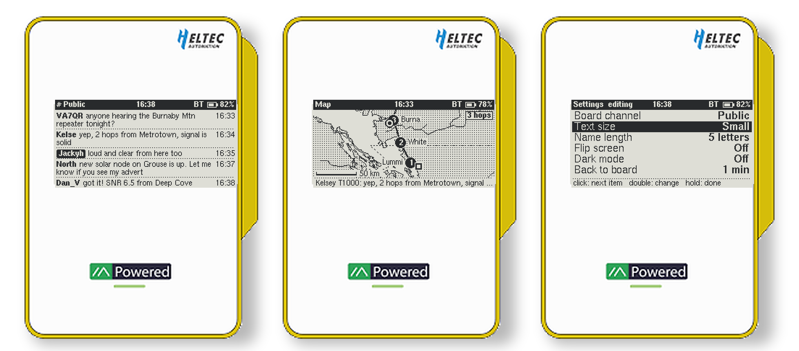
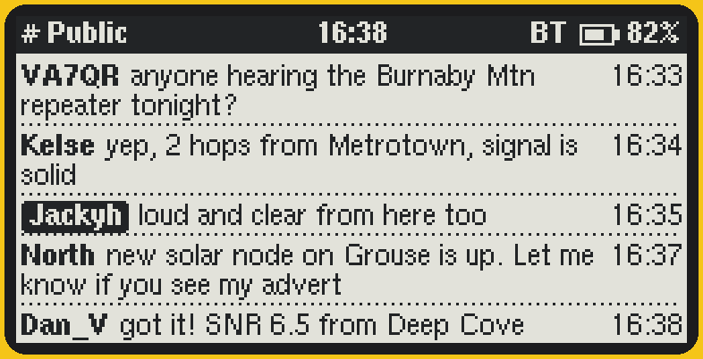
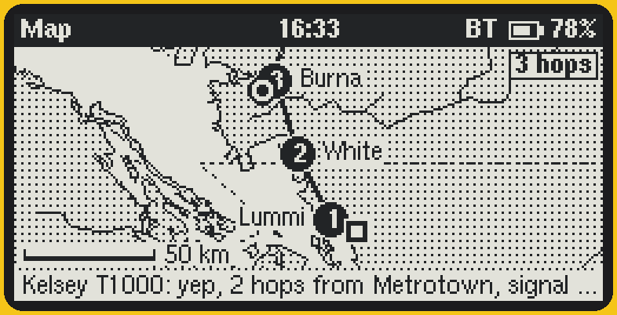
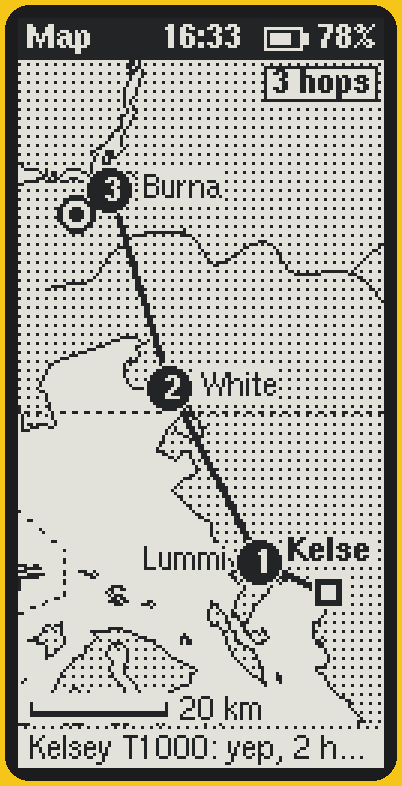
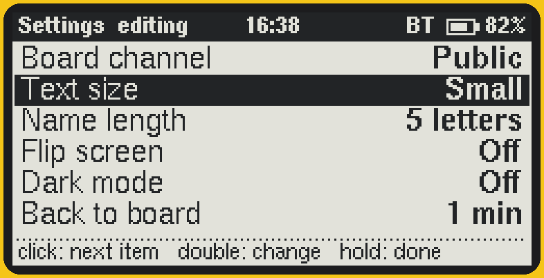
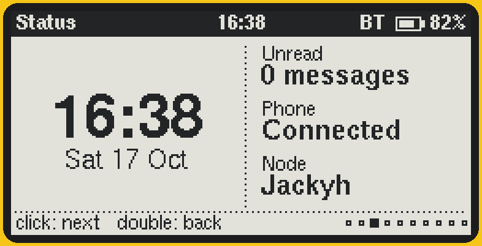

# MeshCore Message Board for the Heltec MeshPocket

Custom firmware for the [Heltec MeshPocket](https://heltec.org/project/meshpocket/) that turns its e‑ink screen into a live message board and route map. It's built on [MeshCore](https://github.com/meshcore-dev/MeshCore) v1.18.0 (companion radio, Bluetooth) and works with the regular MeshCore phone app.

<p align="center">
  
</p>
<p align="center"><b>Message board</b> &nbsp;·&nbsp; <b>Live route trace</b> &nbsp;·&nbsp; <b>On device settings</b></p>
<p align="center">▶️ <a href="docs/messageboard/demo.mp4">Watch the 30 second demo</a> &nbsp;·&nbsp; ⬇️ <a href="../../releases/latest">Download the firmware</a></p>

## What it does

**📋 Message board home screen.** The public channel shows as a live feed, newest message at the bottom, drawn at the screen's full resolution. Your own messages are tagged so they stand out, and a double click scrolls back through recent messages.

**🗺️ Live route trace.** The map page shows the path each incoming message took, hop by hop, through the repeaters it passed, on an offline map. The message and hop count show on screen, and the route stays up until the next message arrives. Set it on your desk and watch the mesh at work.

**🧭 Cleaner navigation.** One button with a hint at the bottom of every page, plus a settings page right on the device.

<p align="center">
  
  
</p>
<p align="center">
  
  
  
</p>

## Improvements over stock MeshCore

| | Stock MeshCore on MeshPocket | This firmware |
|---|---|---|
| Screen rendering | A 128 by 128 layout stretched unevenly onto the 250 by 122 panel | Drawn at the panel's native resolution with crisp fonts |
| Home screen | Unread count | Live message board for your chosen channel |
| Map | None | Offline map with clustered nodes and live message routes |
| Settings on device | No settings page | Channel, text size, name length, time zone, flip, dark mode and more |
| Ghosting | Quick refreshes only, ghosting builds up | Clean full refresh on page changes, new messages and on a schedule |
| Fading text | Panel voltage left on, text fades lighter | Panel powered off after each update, text stays dark and uses less battery |
| Time zone | UTC unless set from a command line | Time zone setting with automatic daylight saving |
| Hop counts | Wrong when longer repeater IDs are in use | Read correctly for 1, 2 and 3 byte IDs |
| Header updates | Clock and battery redraw every minute | Only redraw when something happens, so the screen stays still |

## Getting started

### 1. Download

Open the [**Releases**](../../releases) page and download the latest `.uf2` file.

> The map currently covers the **West Coast of North America** in detail (southern Vancouver Island and the Lower Mainland down through Puget Sound to Olympia) with coarser coverage of the rest of BC and Washington, and an overview from southern Alaska to the Mexican border. Everything else works anywhere; outside that area the map just won't show coastlines yet. See [Map regions](#map-regions) to build your own.

### 2. Flash it

1. Connect the **magnetic pogo pin cable** to the side of the MeshPocket. The USB‑C port only charges and won't work for flashing.
2. **Double press the reset button.** A drive appears on your computer.
3. **Drag the `.uf2` file onto that drive.** The MeshPocket reboots into the new firmware on its own.

Your contacts, channels and keys are kept.

### 3. First time setup

1. **Pair with the MeshCore app** as usual (default Bluetooth PIN `123456` unless you've changed it). The app sets the clock.
2. **Set your location in the app** so the map can place you.
3. **Set your time zone on the device:** go to the Settings page, hold the button to edit, click down to *Time zone*, then double click to change it. Hold again to save.

## Using it

| Button | What it does |
|---|---|
| **Click** | Next page (on the board, scroll forward when you've scrolled back) |
| **Double click** | Previous page (on the board, scroll back through older messages) |
| **Hold** | The page's action, shown at the bottom of each page |

**Pages:** Message board, Map, Bluetooth, Status, Recently heard, Radio, Advert, Repeaters nearby, Settings, Power.

**Message board.** Shows the channel picked in Settings (Public by default). Other people's names are shortened (5 letters by default) to leave room for the message. Hold to switch between small and large text. After a minute on any other page it returns to the board (adjustable).

**Map.** With no messages yet it shows all nodes with a known location, centred on you. When a message arrives, the map fits itself to that message's route: the sender is a square, each repeater is a numbered circle, and you're the ringed circle. Hops without a known location are drawn dotted. The footer shows the message and the corner shows the hop count. Hold to switch between landscape and portrait. The map page never jumps back to the board on its own, so you can leave it watching.

**Settings.** Board channel, time zone, text size, name length, flip screen, dark mode, back to board timer, clean refresh frequency and map layout. Saved on the device.

### Going back to stock MeshCore

Flash the official firmware from [flasher.meshcore.io](https://flasher.meshcore.io) the same way.

## How routes are worked out

Every message that floods across the mesh carries a list of the repeaters that passed it along, stored as short IDs (the first 1 to 3 bytes of each repeater's key). The firmware matches each ID against repeaters in your contacts that share a location. With short IDs, two repeaters can share an ID; when that happens it picks the combination that gives the shortest overall path. Repeaters only appear if your device has heard their advert with a location, so routes get more complete over time.

## Map regions

The map is compiled into the firmware from [OpenStreetMap](https://www.openstreetmap.org) coastlines and [Natural Earth](https://www.naturalearthdata.com) lakes, rivers and borders, at three detail levels. To make a build for your area:

1. Edit the `LEVELS` boxes in [`tools/meshpocket_map/gen_map.py`](tools/meshpocket_map/gen_map.py) (instructions at the top of the file).
2. Run it to regenerate `examples/companion_radio/ui-new/MapData.h`.
3. Build as below.

Regional builds for more areas are planned. Open an issue if you'd like yours added.

## Building from source

```bash
pip install platformio
pio run -e Mesh_pocket_companion_radio_ble
python3 bin/uf2conv/uf2conv.py -f 0xADA52840 -c \
  .pio/build/Mesh_pocket_companion_radio_ble/firmware.hex -o meshpocket-messageboard.uf2
```

The new code lives in `examples/companion_radio/ui-new/` (`NativeScreens.h`, `MessageBoard.h`, `MapView.h`, `EinkUI.h`, `UiSettings.h`) and is only enabled for the MeshPocket build (`-D UI_MESSAGE_BOARD`), so other boards are unaffected.

## Credits and licenses

- [MeshCore](https://github.com/meshcore-dev/MeshCore) by the MeshCore team, MIT license. The original README is in [README-MeshCore.md](README-MeshCore.md).
- Map data © [OpenStreetMap contributors](https://www.openstreetmap.org/copyright), available under the [Open Database License](https://opendatacommons.org/licenses/odbl/), via [geo-maps](https://github.com/simonepri/geo-maps).
- Lakes, rivers and borders from [Natural Earth](https://www.naturalearthdata.com) (public domain).
- Fonts from [u8g2](https://github.com/olikraus/u8g2), display driver [GxEPD2](https://github.com/ZinggJM/GxEPD2).

This is an independent community project, not affiliated with Heltec or the MeshCore team. Flash at your own risk.
